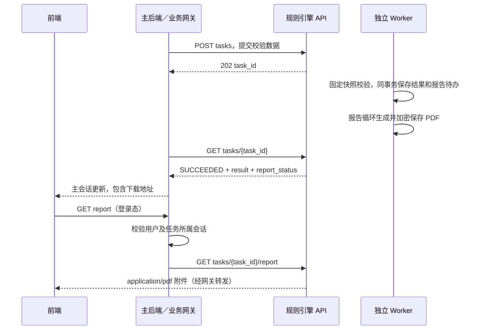

# 前端 PDF 报告下载接口

当前公开文档共三条 API，分工如下：

| 调用方 | API | 用途 |
| --- | --- | --- |
| 上游后端 | POST /api/v1/rule-engine/tasks | 提交结构化校验任务 |
| 上游后端 | GET /api/v1/rule-engine/tasks/{task_id} | 查询执行状态，读取 JSON 校验结果 |
| 前端 | GET /api/v1/rule-engine/tasks/{task_id}/report | 下载已完成任务的 PDF 二进制 |

前两条对接见 [异步任务 API](RULE_TASKS_API.md)。前端不用再直接轮询这两条内部 API。
主后端把任务状态、校验结果与 report_url 关联到自己的审核会话，并通过主会话查询／推送告知前端。
任务 SUCCEEDED 后报告异步生成；查询响应增加 report_status/report_error。仅 report_status=READY 时 report_url 有值，其他状态为 null。
前端拿到校验 SUCCEEDED 和 task_id 后即可调用固定报告 URL；生成中按错误码重试。无需等待主后端继续轮询才开始下载流程。



图中主会话、用户授权及状态推送由主后端对接，当前仓库尚未实现完整主流水线／前端。
已验证的是规则引擎“提交 → Worker → 查询 JSON → 下载 PDF”链路，不等同于整项目上传审核已完成。
报告明确为“规则引擎校验报告”，主流程未汇总的抽取／跨源结果不能凭空加入最终裁决。

## 请求与成功响应

```http
GET /api/v1/rule-engine/tasks/{task_id}/report
Accept: application/pdf
```

无请求体；task_id 为 UUID。只接受未过期且校验 SUCCEEDED、报告 READY 的任务。
SUCCEEDED 的三种业务 verdict 均可导出：AUTO_PASS、NEED_USER_FIX、MANUAL_TRIAGE。
“执行成功”和“规则校验通过”是两个概念，执行 FAILED 没有有效校验报告。

成功返回 HTTP 200 和实际 PDF 字节，不是 JSON、Base64 或服务器文件路径。

| 响应头 | 说明 |
| --- | --- |
| Content-Type: application/pdf | 前端按二进制接收 |
| Content-Disposition: attachment; filename="crosstax-rule-report-任务UUID.pdf" | 不在文件名中暴露姓名或 TIN |
| Content-Length | PDF 实际字节长度，由响应框架生成 |
| Cache-Control: no-store | 不允许代理／浏览器缓存敏感报告 |
| X-Content-Type-Options: nosniff | 不根据内容猜测其他类型 |
| X-Report-SHA256 | PDF 原始字节 SHA-256，供客户端校验下载完整性 |
| X-Report-Template-Version | 当前 crs-rule-report-v1 |

上述下载及摘要头已通过 CORS expose_headers 暴露。配置 CORS_ORIGINS 为实际前端 HTTPS 域名；不能只保留本地开发域名。
PDF 由后台从保存的请求与 ValidationResponse 自动生成，并加密保存在 PostgreSQL。下载只读存储，不刷新规则、不调用模型、不重新渲染。
同一任务在相同渲染构建下重复导出的 PDF 字节一致；升级模板、字体或 ReportLab 时应升模板版本，不保证跨构建字节相同。

## 状态与错误码

错误始终返回 JSON `{ "code": "...", "message": "..." }`，不返回伪装成 PDF 的错误文档。
先校验任务状态，再检查渲染容量；即使渲染器繁忙，未完成任务仍返回 REPORT_NOT_READY。

| 条件 | HTTP | code |
| --- | --- | --- |
| PENDING／RUNNING | 409 | REPORT_NOT_READY |
| FAILED | 409 | REPORT_TASK_FAILED |
| UUID 合法但不存在 | 404 | TASK_NOT_FOUND |
| 任务已过期，包括生成期间到期 | 410 | TASK_EXPIRED |
| task_id 不是合法 UUID | 422 | VALIDATION_ERROR |
| 校验成功，报告 PENDING/RUNNING 或历史待补建 | 409 | REPORT_GENERATING |
| 报告最终 FAILED | 503 | REPORT_GENERATION_FAILED |
| 存储结果／文件不完整或不一致 | 503 | REPORT_DATA_UNAVAILABLE |
| 密钥缺失 | 503 | TASK_ENCRYPTION_UNAVAILABLE |
| 下载解密或其他读取错误 | 503 | REPORT_UNAVAILABLE |

生成超限、字体错误等由后台生成任务处理，最终反映为 report_error 和 REPORT_GENERATION_FAILED，不再由下载触发。

REPORT_GENERATING 提示“报告生成中，请稍后重试”，带 Retry-After: 2；前端可据此有界重试。
REPORT_NOT_READY 应等待主后端状态更新；REPORT_GENERATION_FAILED 提示失败并停止普通轮询，不无限重试，也不附 Retry-After。
前端需要处理 ArrayBuffer／Blob 形式承载的 JSON 错误，不能一律保存为 .pdf。

## 前端 Axios 包装示例

放在队友 frontend/src/api/ 中，组件只调用包装函数。api 为项目已经配置好 baseURL 和登录态的 AxiosInstance。
baseURL 应指向业务网关；report_url 是规则接口的相对路径，网关需保留该路径或统一映射。

```typescript
import axios, { type AxiosInstance } from "axios";

export async function downloadRuleReport(api: AxiosInstance, taskId: string): Promise<void> {
  let data: ArrayBuffer;
  let expectedHash = "";
  try {
    const response = await api.get<ArrayBuffer>(
      `/api/v1/rule-engine/tasks/${encodeURIComponent(taskId)}/report`,
      { responseType: "arraybuffer", timeout: 20000 }
    );
    if (!String(response.headers["content-type"]).includes("application/pdf")) {
      throw new Error("服务器未返回 PDF");
    }
    data = response.data;
    expectedHash = String(response.headers["x-report-sha256"] ?? "");
  } catch (error: unknown) {
    if (axios.isAxiosError<ArrayBuffer>(error) && error.response?.data instanceof ArrayBuffer) {
      try {
        const body: unknown = JSON.parse(new TextDecoder().decode(error.response.data));
        if (body && typeof body === "object" && "code" in body && typeof body.code === "string") {
          throw new Error(body.code);
        }
      } catch (decodedError: unknown) {
        if (decodedError instanceof Error && !(decodedError instanceof SyntaxError)) throw decodedError;
      }
    }
    throw error;
  }
  if (expectedHash) {
    const digest = await crypto.subtle.digest("SHA-256", data);
    const actual = Array.from(new Uint8Array(digest), b => b.toString(16).padStart(2, "0")).join("");
    if (actual !== expectedHash.toLowerCase()) throw new Error("PDF_HASH_MISMATCH");
  }
  const url = URL.createObjectURL(new Blob([data], { type: "application/pdf" }));
  const link = document.createElement("a");
  link.href = url;
  link.download = `crosstax-rule-report-${taskId}.pdf`;
  document.body.appendChild(link);
  link.click();
  link.remove();
  setTimeout(() => URL.revokeObjectURL(url), 60000);
}
```

下面的包装在生成中每 2 秒重试（当前 Retry-After 固定为 2），在 60 秒轮询窗口内重试（每次 HTTP 另有 20 秒超时）；生成失败、未完成、过期等直接交给 UI 提示。前端仍只调用报告 GET：

```typescript
export async function downloadWhenReady(api: AxiosInstance, taskId: string): Promise<void> {
  const deadline = Date.now() + 60000;
  while (true) {
    try {
      await downloadRuleReport(api, taskId);
      return;
    } catch (error: unknown) {
      if (!(error instanceof Error) || error.message !== "REPORT_GENERATING") throw error;
      if (Date.now() + 2000 >= deadline) throw new Error("REPORT_WAIT_TIMEOUT");
      await new Promise<void>(resolve => setTimeout(resolve, 2000));
    }
  }
}
```

实际 UI 在组件卸载／取消时应通过现有请求封装中止等待；超出等待上限可让用户稍后重新点击，不会重新创建校验任务或重新生成已保存文件。

Ant Design 导出按钮在主后端确认规则 task.status===SUCCEEDED 后即可启用；生成中显示 loading，有限重试报告 GET，避免重复点击。report_url 尚为 null 时也可按 task_id 构造文档定义的固定路径。
若整个会话还在跨源研判，报告仅代表规则阶段；主后端若要求审核全部完成后才能下载，应再按主会话状态控制按钮与授权。

## 后端联调

先配置共享任务密钥、发布规则并启动 API 和 Worker，命令见异步任务文档。
提交个人／实体／控权人任务样例，GET 查询得到 SUCCEEDED 和 report_url 后：

```bash
# URL、UUID 换成部署后的实际值；业务网关所需登录头沿用团队现有方式
curl --fail-with-body -D /tmp/report-headers.txt \
  https://your-api.example.com/api/v1/rule-engine/tasks/实际任务UUID/report \
  --output /tmp/rule-report.pdf
```

先检查 HTTP 状态及 Content-Type；curl 在错误时也可能将 JSON 写入指定文件，不应将它作为有效 PDF。
新增 rule_pdf_reports 和 Alembic 迁移；PDF 加密保存 PG，任务与报告共同遵循 24 小时保留策略，不使用暂存磁盘。

## 阿里云运行

- 使用更新后的同一镜像，ReportLab 和内嵌字体在 backend/reports 下，Docker COPY backend 已覆盖；字体及许可已验证进入 wheel。
- API／Worker 的 RDS、共享加密密钥、规则与 Python 版本保持一致；无需 PDF 浏览器服务、Redis 或 OSS。
- 仅报告 GET 路由对前端开放；提交／状态 JSON 两条仍作为上游内部调用。由业务网关完成登录和 session/task 归属授权，再转发 PDF 二进制与下载头。
- 当前规则 API 没有自行实现用户鉴权；UUID 不是授权机制。云上发布前必须接入主后端／网关权限，不能裸露内部服务公网端口。
- 反向代理报告超时建议大于 20 秒，并保留 Content-Disposition、摘要头及 no-store；HTTPS 下使用前端 crypto.subtle。
- Worker 进程内独立报告循环最多一个渲染线程，与规则循环共享一连接池；下载 API 不渲染，保持 API 2 + Worker 1 的连接预算。
- 源 JSON 最多 2 MiB、问题／检查／税籍记录合计最多 5000、100 页及 8 MiB PDF；超限拒绝，不悄悄截断。

## 竞赛本轮不安排的扩展

用户已决定按竞赛周期收尾，下列建议不再列为本轮开发计划；本次也不执行阿里云部署。

1. **主流程最终结果与授权**：实现主 AuditSession 的聚合结果和用户归属，确保下载权限与最终业务状态一致。
2. **下载审计**：记录谁在何时导出了哪个任务、版本及摘要；避免记录 PDF 内容和 TIN。
3. **大型报告与长期留存**：独立导出任务、加密私有 OSS、短期下载签名地址；当前 PG 加密保存适合竞赛规模。
4. **可信证明**：KMS 管理密钥、模板／模型输出版本归档，需要法律签章时使用真实 PDF 签名；SHA-256 只能校验一致性。
5. **展示体验**：人工阅读的精简报告和完整证据附件分层、按法域／主体解释检查项，并提供主流程 HTML 预览。

这些优化未自动引入新云服务或修改队友的主流程；当前已实现的边界见 [详细设计](../engine/PDF_REPORTS.md)。

持久化、恢复、重试及清理以 [异步报告设计](../engine/PDF_REPORTS.md) 为准；此版本替代此前按下载请求实时生成的方案。

## 迁移与运维恢复

云端部署先 `uv run alembic upgrade head`，当前 head 为 20261108_pdf_reports；再部署同一版本 API／Worker。
原 Worker 命令不变：`uv run python -m backend.workers.rule_tasks`，其两个循环并行处理校验和报告。
`--once` 尝试一项校验及一项报告，`--cleanup` 清理两类过期密文。
报告默认三次生成尝试，临时错误按 2、4 秒等退避；超限或不兼容构建立刻失败。
修复故障后，可执行 `uv run python -m backend.workers.rule_tasks --retry-report 任务UUID`，只重排未过期 FAILED 报告；之后常驻 Worker 继续生成。
该内部 CLI 不提供新管理 API，不修改规则结果或覆盖已有 READY 文件。
默认预算配置见 RULE_REPORT_TIMEOUT_SECONDS=15、LEASE_SECONDS=20、HEARTBEAT_SECONDS=3、MAX_ATTEMPTS=3（均带 RULE_REPORT_ 前缀）。
本地十一表迁移与 PostgreSQL 任务到报告链路已验证；云端迁移、网关会话授权和队友主流程仍需部署接入。
