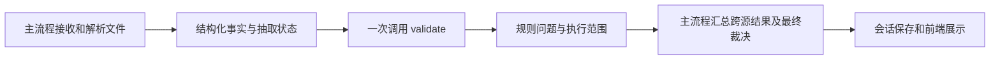

# 上游结构化 CRS 接入与流程边界

现有 `POST /api/v1/rule-engine/validate` 已支持同步后的 D3 嵌套字段。
上游把抽取完成的单持有人 JSON 交给本接口，获得规则问题与检查结论；现有存储实现对调用方透明。
旧平铺／简化多税籍请求仍兼容；新接入优先采用本页格式。实体不要补造出生／成立日期。

## 在主流程中的位置



跨源问题若调用前已知，可通过 indicia_issues 一并传入；若在规则校验后生成，由主流程合并严重度。
不需要为了最终裁决再调用规则引擎。最终任意 BLOCKER → NEED_USER_FIX，仅 WARNING → MANUAL_TRIAGE，无问题 → AUTO_PASS。
HTTP 200 只表示执行成功。规则 AUTO_PASS 不等于抽取、实际跨文档核验和整份法律条件全部通过。
此接口不读 PDF、不调用 Vision、不保存表单或替代主 AuditSession。

## 三类请求

样例全部为合成数据；fingerprint 是演示值，实际由主后端根据原文件计算，不能由模型编造。
HK 证件字段必须来自独立表格字段提取，不能为了满足等值检查直接复制 TIN。

### 个人

```json
{
  "form_data": {
    "document": {
      "is_encrypted": true,
      "structure_tree_available": true,
      "holders_declared": 1,
      "fingerprint": "synthetic-document-hash"
    },
    "holder_type": "INDIVIDUAL",
    "name": {
      "last_name": "CHAN",
      "first_name": "DEMO"
    },
    "birth_date": "20/05/1990",
    "hk_identity": {
      "hkid_or_passport": "A123456(3)"
    },
    "addresses": [
      {
        "type": "RESIDENCE",
        "line1": "Demo Building",
        "city": "Hong Kong",
        "country": "HK"
      }
    ],
    "tax_residencies": [
      {
        "jurisdiction": "HK",
        "basis": "RESIDENCE",
        "tin": "A123456(3)"
      }
    ],
    "declaration": {
      "holder_or_authorized_resolved": true,
      "has_signature": true,
      "signing_date": "04/11/2026"
    }
  },
  "policy": {
    "today": "2026-11-08"
  },
  "indicia_issues": []
}
```

### 实体

```json
{
  "form_data": {
    "document": {
      "is_encrypted": true,
      "structure_tree_available": true,
      "holders_declared": 1,
      "fingerprint": "synthetic-document-hash"
    },
    "holder_type": "ENTITY",
    "name": {
      "entity_legal_name": "DEMO CROSS BORDER LIMITED"
    },
    "hk_identity": {
      "business_registration_number": "12345678"
    },
    "addresses": [
      {
        "type": "RESIDENCE",
        "line1": "Demo Building",
        "city": "Hong Kong",
        "country": "HK"
      }
    ],
    "tax_residencies": [
      {
        "jurisdiction": "HK",
        "basis": "RESIDENCE",
        "tin": "12345678"
      }
    ],
    "declaration": {
      "holder_or_authorized_resolved": true,
      "has_signature": true,
      "signing_date": "04/11/2026",
      "capacity": "Director",
      "signatory_name": "DEMO CHAN"
    },
    "entity": {
      "incorporation_jurisdiction": "HK",
      "incorporation_jurisdiction_source": "FORM",
      "entity_type": "PASSIVE_NFE",
      "controlling_person_names": [
        "DEMO CHAN"
      ]
    }
  },
  "policy": {
    "today": "2026-11-08"
  },
  "indicia_issues": []
}
```

### 控权人

```json
{
  "form_data": {
    "document": {
      "is_encrypted": true,
      "structure_tree_available": true,
      "holders_declared": 1,
      "fingerprint": "synthetic-document-hash"
    },
    "holder_type": "CONTROLLING_PERSON",
    "name": {
      "last_name": "CHAN",
      "first_name": "DEMO"
    },
    "birth_date": "20/05/1990",
    "hk_identity": {
      "hkid_or_passport": "A123456(3)"
    },
    "addresses": [
      {
        "type": "RESIDENCE",
        "line1": "Demo Building",
        "city": "Hong Kong",
        "country": "HK"
      }
    ],
    "tax_residencies": [
      {
        "jurisdiction": "HK",
        "basis": "RESIDENCE",
        "tin": "A123456(3)"
      }
    ],
    "declaration": {
      "holder_or_authorized_resolved": true,
      "has_signature": true,
      "signing_date": "04/11/2026"
    },
    "controlling_person": {
      "controlled_entities": [
        {
          "entity_name": "DEMO CROSS BORDER LIMITED",
          "linked_document_ref": "SYNTHETIC_ENTITY_REF",
          "link_confidence": "NAME_DOB_ONLY",
          "cp_types": [
            "ownership"
          ]
        }
      ]
    }
  },
  "policy": {
    "today": "2026-11-08"
  },
  "indicia_issues": []
}
```

## 字段与约束

| 数据 | 接入要求 |
| --- | --- |
| document | is_encrypted、structure_tree_available、holders_declared 必填；上游负责判断持有人身份块，不能按税籍／所控实体数量计算 |
| document.fingerprint | 提供原始文件指纹；缺失产生复核提示。加密为 true 本身不拒绝，结构树不可用会显示降级 |
| name | 分别保留姓、名、中间名；实体使用 entity_legal_name，is_branch 保留原义 |
| birth_date | 个人／控权人必需；出生地可为空，实体不要求日期 |
| addresses | 1–2 项，type 为 RESIDENCE/MAILING；一项现居／营业地址，同类不重复；现居城市与国家必需 |
| tax_residencies | 至少一项；新结构不设 20 行上限，实际由 1 MiB 请求体上限约束；不是持有人计数 |
| jurisdiction / country | ISO 两位大写代码；代码合法和 TIN 规则已配置是不同检查，合法但未覆盖转复核 |
| basis | RESIDENCE 或 POEM；POEM 为实体独立事实，需与 entity.poe_jurisdiction 相符，不直接认定税收居民身份 |
| tin / no_tin_reason | 互斥；无 TIN 原因 A/B/C，B 要解释，长度取外部策略；C 的未核实标志传 false 也不能关闭适用性复核 |
| hk_identity | 独立 HKID／护照来源及 BR 来源；HK TIN 执行对应等值检查，报告字段路径，不回显号码 |
| entity | 保留分类、子项、注册地及来源、控权人和实际管理地；被动实体不能省略控权人，高管兜底不允许空信息 |
| controlling_person | 所控实体 1–3 项；每项独立 cp_types，不能压成一个全局类型；低置信或缺引用转复核 |
| declaration | 授权选项须消解；实体或不同签署人要 Capacity；明确以 POA 签署须提供附件；未知角色映射转复核 |
| policy.today | 主后端传入 ISO 业务日期；数值时间戳不接受。表单日期可用 ISO 或 dd/mm/yyyy，执行前规范为 ISO |

未知字段返回 422。上游 schema 中“可以省略但不可为 null”的对象（如 entity），不适用时请省略，而不是传 null。
当前 Pydantic 模型与 OpenAPI 已按这一语义处理；字段模型集合有与 source schema 的一致性测试。
可选项与不适用字段不会仅因为空而报必填错误；必要字段缺失或业务无效返回 200 + issues。

## 返回结果与展示

沿用现有 verdict、issues、residence_results、check_items、issue_origins、review_scope、execution。
嵌套数据路径如 name.last_name、addresses.0.city、tax_residencies.0.tin、declaration.capacity 可直接定位前端字段。
香港等值问题 message 同时给出另一来源字段路径；TIN 轨迹记录 hk_identity_equality，不能只展示格式通过。
多持有人拒收时不再执行后续字段或税号检查，review_scope 对应标明未执行范围。
非法地区原文不作为响应标识回显，jurisdiction_code 为空字符串，调用方以 index 和 issue.field 定位原输入。

execution.input_fingerprint 对规范后的字段、完整策略和上游问题取哈希；等价 ISO／dd/mm/yyyy 日期得到相同指纹。
execution.form_policy_id 记录外部表单策略版本；rule_version_id 仍表示 TIN 快照，不能把两者混为一个版本。
表单策略是项目检查配置，其日期不代表法律生效日。后台 TIN 候选发布不会修改该文件。
规则升级影响分析也接受同样的嵌套 form_data，固定表单策略并将 form_policy_id 绑定报告。

include_guidance 默认 false。大量问题超过工具预算时，固定提示降级；最多返回 300 个补正动作，
guidance.omitted_action_count 给出未展开动作数。完整 issues 仍返回，前端不能据动作数推定问题总数。
旧客户端若对响应模型严格拒绝新增字段，需要同步更新 OpenAPI 模型。

## 必须由上游补足的事实

当前 schema 的 Ref. No./收件机构、实际 KYC 第二值、对方文档和持股／实体形式事实仍有表达缺口。
实体控权人的实际对应文档缺失时转复核；控权人请求带可靠引用且 link_confidence=HIGH 时，
按上游已确认的关联声明检查，不声称本接口已读取或核实对方原件。
不要把姓名＋出生日期兜底链接标为已确认，不要用空 indicia_issues 代替尚未执行的跨源检查。

[架构审查与职责矩阵](../engine/ARCHITECTURE_REVIEW.md)列明已修复项与仍需上游／契约维护者处理的要求。
不由模型填补真实事实，也不将未知门槛或法律生效日写成通过结果。

## 调用

```bash
curl -X POST http://localhost:8000/api/v1/rule-engine/validate \
  -H 'Content-Type: application/json' \
  --data-binary @assets/crs-templates/crs-structured-individual-request.json
```

当前活动 global v4 下，个人样例预期 AUTO_PASS；被动实体及低置信控权人样例预期 MANUAL_TRIAGE。
配置、通用错误码和旧格式见 [完整接口文档](RULE_ENGINE_API.md)，交互文档仍为 `/docs`。
