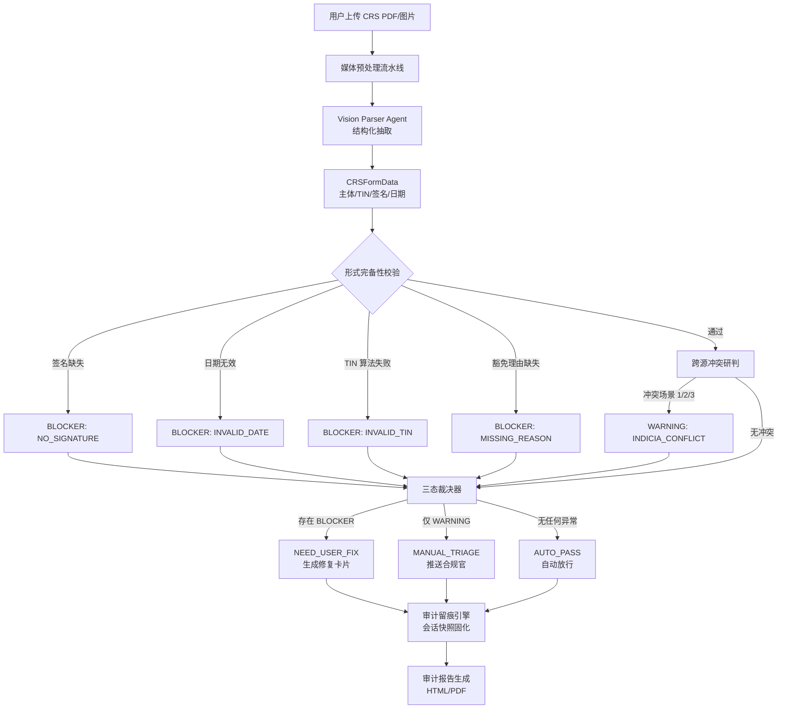

# CrossTax AI — 产品需求文档 (PRD)

> **版本：** v1.0 | **日期：** 2026-10-22 | **作者：** PM  
> **输入来源：** `docs/crosstax-ai-solution (from ppt).md`、`docs/business-workflow-design.md`  
> **状态：** 草案，待团队评审

---

## 1. 背景 (Background)

### 1.1 业务背景

跨境资金结算链路中，CRS（共同申报准则）税籍自我证明是合规审核的关键环节。当前流程存在严重的效率与准确性问题：

- **审核慢：** 传统人工多轮补件耗时 3–7 个工作日，拖慢商户开户与资金结算
- **错填率高：** 表单错填率超过 35%，大量人力消耗在反复沟通与退回修正
- **跨源冲突难发现：** 注册资料、护照、离岸账户、海外仓地址分散在不同系统，人工无法快速交叉核验，漏报/误报可能引发穿透审计与处罚

### 1.2 用户场景

| 角色 | 场景 | 痛点 |
|------|------|------|
| **跨境商户** | 提交 CRS 自证表单申请开户/结汇 | 不清楚填写规则，反复被退回补件，资金到账延迟 |
| **合规审核官** | 审核商户提交的税籍声明 | 需人工比对多源数据，判断税籍指示冲突，效率低且易遗漏 |
| **系统管理员** | 维护税规规则库、管理审计日志 | 规则更新需重启系统，无法快速响应 OECD 规则变更 |

### 1.3 数据支撑

| 指标 | 现状 | 来源 |
|------|------|------|
| 人工审核时长 | 3–7 个工作日 | 项目背景数据 |
| 表单错填率 | >35% | 项目背景数据 |
| 目标审核时长 | 秒级自动诊断 | 产品目标 |

### 1.4 战略对齐

本项目为 **AI Campaign 2026 竞赛** 参赛方案，定位 Compliance-as-a-Service 能力。核心价值：
- 将税籍合规前置到开户与结算流程，降低合规摩擦
- 通过多智能体串联审核，实现从"反复补件"到"实时诊断"的体验跃迁
- 提供可追溯的审计底稿，满足金融级合规要求

---

## 2. 目标 (Objectives)

### 2.1 核心目标

构建 CrossTax AI 全球自适应合规审核引擎，通过多智能体串联实现 CRS 表单的自动识别、校验、冲突研判与分流处置，将审核时长从 3–7 天缩短至秒级。

### 2.2 量化指标

| 指标 | 目标值 | 衡量方式 |
|------|--------|----------|
| 端到端审核响应时间 | ≤ 30 秒（含 Vision API 调用） | 系统日志 |
| 表单字段抽取准确率 | ≥ 90%（结构化 JSON 字段级） | 5 个典型 Case 测试 |
| TIN 校验准确率 | 100%（规则命中场景） | 单元测试 |
| 三态裁决正确率 | 100%（5 个 Case 全覆盖） | 集成测试 |
| 审计底稿完整率 | 100%（每笔审核均有可溯源记录） | 数据校验 |
| 规则热重载生效时间 | ≤ 3 秒（无需重启服务） | 演示验证 |

### 2.3 优先级

| 级别 | 目标 |
|------|------|
| **P0 必须达成** | 五步审核流水线端到端跑通、三态裁决、审计留痕、Streamlit 演示界面 |
| **P1 核心加分** | 规则热重载演示、跨源冲突研判、补正修复卡片 |
| **P2 锦上添花** | 审计报告 PDF 导出、多法域规则扩展（超出 CN/HK/SG） |

---

## 3. 范围 (Scope)

### 3.1 纳入范围 (In Scope)

| 模块 | 说明 |
|------|------|
| 数据接入与媒体预处理 | PDF/图片上传、解析、清洗、Base64 编码 |
| Vision Parser Agent | 调用 Vision API 抽取结构化字段（主体、TIN、签名等） |
| 声明式规则库 + 热重载 | JSON 配置存储、内存原子替换、版本绑定 |
| 形式完备性校验 | 签名判定、日期校验、TIN 算法校验、Reason A/B/C 逻辑 |
| 跨源冲突研判 | 比对商户底表，检测三类税籍指示冲突 |
| 三态裁决器 | AUTO_PASS / NEED_USER_FIX / MANUAL_TRIAGE 分流 |
| 审计留痕引擎 | 会话快照、规则版本绑定、全链路溯源 |
| 审计报告生成 | Jinja2 模板渲染 HTML 报告 |
| Streamlit 演示 UI | 文件上传、实时看板、修复卡片、规则同步模拟 |
| Mock 数据集 | 5 个典型 Case + 商户底表 + 规则配置 |

### 3.2 排除范围 (Out of Scope)

| 项目 | 原因 |
|------|------|
| 真实商户系统对接（KYC/CRM API） | 竞赛环境无真实数据源，使用 Mock 替代 |
| 生产级 RBAC 与多租户隔离 | 竞赛 Demo 不涉及多租户场景 |
| 爬虫自动获取 OECD 最新规则 | 方案明确"零爬虫"，规则由配置文件模拟 |
| 移动端适配 | 演示界面为 Streamlit Web，不涉及移动端 |
| 多语言支持 | 首期仅支持中文界面 + 英文表单字段 |

### 3.3 用户故事

| ID | 角色 | 故事 | 验收标准 |
|----|------|------|----------|
| US-01 | 商户 | 我想上传 CRS 表单 PDF/图片，让系统自动审核，以便快速完成开户 | 上传后 30 秒内返回审核结论 |
| US-02 | 商户 | 我想看到通俗的修改建议，当我的表单有错误时，以便快速修正重新提交 | BLOCKER 场景生成修复卡片，字段级提示 |
| US-03 | 合规官 | 我想看到跨源冲突的高亮证据链，当商户存在税籍指示矛盾时，以便快速决策 | WARNING 场景展示冲突项与置信度 |
| US-04 | 合规官 | 我想下载结构化的审计底稿报告，以便存档和应对监管抽检 | HTML 报告可下载，含完整溯源信息 |
| US-05 | 管理员 | 我想一键加载最新 OECD 规则补丁，无需重启服务，以便快速响应规则变更 | 热重载 ≤ 3 秒生效，演示可见 |
| US-06 | 评审 | 我想看到 5 个典型 Case 的完整演示，覆盖三态裁决，以便评估系统能力 | 5 个 Case 全部可正常演示 |

### 3.4 功能清单

| 功能 | 优先级 | 依赖 |
|------|--------|------|
| 媒体预处理流水线（PDF/图片） | P0 | — |
| Vision Parser Agent（结构化抽取） | P0 | 媒体预处理 |
| TIN 规则引擎（正则 + 校验位算法） | P0 | Vision Agent |
| 规则热重载机制 | P1 | TIN 规则引擎 |
| 形式完备性校验（签名/日期/Reason） | P0 | Vision Agent |
| 跨源冲突研判模块 | P1 | 商户底表 + Vision Agent |
| 三态裁决器 | P0 | 上述所有校验模块 |
| 审计留痕引擎 | P0 | 裁决器 |
| 审计报告生成（HTML） | P1 | 审计引擎 |
| Streamlit 演示 UI | P0 | 后端 API |
| Mock 数据集（5 Case + 商户底表） | P0 | — |

---

## 4. 详细功能与流程 (Detailed Features & Flows)

### 4.1 业务流程图

### 4.2 功能详述

#### F1: 数据接入与媒体预处理

| 项 | 说明 |
|----|------|
| **输入** | 单/多页 PDF 或 JPG/PNG/WEBP 图片 |
| **处理** | PDF → pdf2image 栅格化（300 DPI RGB）；图片 → EXIF 自动纠正 + 等比缩放（长边 ≤ 2048px） |
| **输出** | Base64 编码的标准化单页图像流 |
| **边界** | 不支持加密 PDF；超大文件（>50MB）提示压缩后重试 |

#### F2: Vision Parser Agent

| 项 | 说明 |
|----|------|
| **输入** | Base64 图像流 |
| **处理** | 调用第三方 Vision API，抽取字段并映射至强类型 CRSFormData |
| **输出字段** | 账户持有人姓名/实体名、出生日期/成立日、现居住地/常设地址、申报国家代码（ISO 2字码）、TIN、has_no_tin 标记、Reason A/B/C 及解释、has_signature、signing_date |
| **置信度** | 每个字段附带抽取置信度，低于阈值标记为需人工复核 |

#### F3: TIN 规则引擎 + 热重载

| 项 | 说明 |
|----|------|
| **校验流程** | 清洗（剥离空格/连字符/括号）→ 正则匹配（长度+字符集）→ 算子分发（MOD11_2 / HKID_WEIGHT / NRIC_WEIGHT / REGEX_ONLY）→ 兜底（未配置国家执行 4–30 位基础校验） |
| **规则存储** | `rules_v1_base.json`（基准）+ `rules_v2_patch.json`（增量补丁） |
| **热重载** | `engine.load_rules(path)` 原子替换内存字典，无需重启，≤ 3 秒生效 |
| **版本绑定** | 每次审核会话强绑定 `rule_version_id`，确保审计可溯源 |

#### F4: 形式完备性校验

| 校验项 | 规则 | 失败标记 |
|--------|------|----------|
| 签名 | `has_signature == True` | BLOCKER: NO_SIGNATURE |
| 签署日期 | 不可晚于当前日期，不可早于合理阈值 | BLOCKER: INVALID_DATE |
| TIN 算法 | 校验位计算通过 | BLOCKER: INVALID_TIN |
| 豁免理由 | `has_no_tin == True` 时必须选择 Reason A/B/C | BLOCKER: MISSING_REASON |
| Reason B 解释 | `reason_explanation` 必填且长度 ≥ 5 | BLOCKER: MISSING_REASON |

#### F5: 跨源冲突研判

| 冲突场景 | 判定逻辑 | 严重级别 |
|----------|----------|----------|
| 场景 1：单国申报 vs 境外运营 | 仅申报单国税籍，但商户底表显示境外常设实体或运营仓储 | WARNING |
| 场景 2：离岸主体税籍隐瞒 | 注册于离岸金融中心（HK/SG/KY），但 CRS 中隐瞒该管辖区税务居民身份 | WARNING |
| 场景 3：主体名称跨源冲突 | 表单声明姓名与 KYC 法定注册主体不一致 | WARNING |

#### F6: 三态裁决器

| 输入条件 | 裁决 | 业务动作 |
|----------|------|----------|
| 存在任意 BLOCKER | NEED_USER_FIX | 暂缓开户/结汇，生成修复卡片 |
| 无 BLOCKER，存在 WARNING | MANUAL_TRIAGE | 推送合规官审查工作台 |
| 无任何异常 | AUTO_PASS | 纳税声明生效，激活结算 |

#### F7: 审计留痕与报告

| 项 | 说明 |
|----|------|
| 会话快照 | 会话ID + 商户ID + 原始文件哈希 + 结构化数据 + 命中规则 + 规则版本号 + 裁决时间戳 |
| 报告格式 | Jinja2 模板渲染 HTML（P1 扩展 PDF） |
| 溯源能力 | 支持从报告穿透至原始文件 + 规则版本 + Agent 结论 |

#### F8: Streamlit 演示 UI

| 区域 | 功能 |
|------|------|
| 样本选择与文件预览 | 本地上传 / 切换 5 个预置 Case，原件与抽取结果并列 |
| 规则同步模拟区 | 一键"加载最新 OECD 规则补丁"，验证热重载 |
| 实时研判看板 | Agent 执行阶段状态 + 最终裁决徽章 |
| 修复卡片区 | BLOCKER 场景的通俗整改建议 |
| 审计底稿区 | 一键下载/预览 HTML 报告 |

### 4.3 变更高亮（相对现有流程）

| 环节 | 现状 | 新方案 | 变更标记 |
|------|------|--------|----------|
| 表单审核 | 人工逐字段核对 | Vision Agent 自动抽取 + 规则引擎校验 | **新增** |
| 冲突发现 | 人工跨系统比对 | 跨源研判模块自动检测 | **新增** |
| 审核结论 | 人工判定 | 三态裁决器自动分流 | **新增** |
| 规则更新 | 重启服务 | 热重载秒级生效 | **新增** |
| 审计留痕 | 纸质/分散电子记录 | 结构化会话快照 + 一键报告 | **新增** |

### 4.4 测试重点

| 测试类型 | 场景 | 关注点 |
|----------|------|--------|
| 端到端 | 5 个典型 Case 完整跑通 | 三态裁决全覆盖 |
| 边界 | 未配置法域的 TIN | 兜底策略（4–30 位）是否正常 |
| 边界 | 空文件 / 损坏 PDF | 错误提示是否友好 |
| 性能 | Vision API 超时 | 降级策略与重试机制 |
| 热重载 | 加载 v2 补丁后校验 | 规则即时生效 + 版本绑定正确 |
| 审计 | 报告穿透溯源 | 原始文件哈希 + 规则版本可查 |

---

## 5. 非功能需求 (Non-Functional Requirements)

### 5.1 性能

| 指标 | 目标 |
|------|------|
| 端到端响应时间 | ≤ 30 秒（含 Vision API 调用） |
| 规则热重载生效时间 | ≤ 3 秒 |
| 并发支持 | 竞赛演示场景，单实例即可 |

### 5.2 安全

| 要求 | 说明 |
|------|------|
| 传输加密 | HTTPS/TLS |
| 存储加密 | 敏感字段（TIN、商户信息）加密存储 |
| 数据最小化 | 仅采集审核必需字段 |
| 审计不可篡改 | 会话快照一旦写入不可修改 |

### 5.3 运维确认

- 部署目标：阿里云 ECS / 容器服务
- 运维确认项：环境变量外置、日志采集、健康检查接口
- 运维团队确认状态：**待确认**（需团队内运维负责人签字）

### 5.4 客服 SOP

| 场景 | 处理方式 |
|------|----------|
| 商户收到 NEED_USER_FIX | 查看修复卡片，按提示修正后重新提交 |
| 商户收到 MANUAL_TRIAGE | 等待合规官联系，补充证明材料 |
| 商户对审核结论有异议 | 联系合规官，提供原始文件 + 审计底稿编号 |

---

## 6. 数据追踪 (Data Tracking)

### 6.1 埋点方案

| 事件名 | 触发条件 | 参数 |
|--------|----------|------|
| `file_uploaded` | 用户上传文件 | file_type, file_size, case_id |
| `vision_extract_completed` | Vision Agent 完成抽取 | field_count, avg_confidence, duration_ms |
| `tin_validated` | TIN 校验完成 | country_code, result (pass/fail), algorithm_used |
| `form_issue_detected` | 检测到表单问题 | issue_type, severity (BLOCKER/WARNING) |
| `indicia_conflict_detected` | 检测到跨源冲突 | conflict_scenario (1/2/3), confidence_score |
| `verdict_rendered` | 裁决结果生成 | verdict (AUTO_PASS/NEED_USER_FIX/MANUAL_TRIAGE) |
| `rule_hot_reload` | 规则热重载触发 | from_version, to_version, reload_duration_ms |
| `audit_report_downloaded` | 审计报告下载 | session_id, report_format |

### 6.2 看板指标

| 指标 | 计算方式 | 展示频率 |
|------|----------|----------|
| 日均审核量 | COUNT(file_uploaded) / 天 | 每日 |
| 自动通过率 | COUNT(verdict=AUTO_PASS) / COUNT(verdict) | 每日 |
| 平均审核时长 | AVG(duration_ms from upload to verdict) | 每日 |
| BLOCKER 分布 | COUNT(form_issue_detected) GROUP BY issue_type | 每周 |
| 热重载次数 | COUNT(rule_hot_reload) | 每次 |

### 6.3 数据验证

- 埋点数据与系统日志交叉校验，确保事件不丢失
- 每日核对审核量与审计底稿数量一致

---

## 7. 验收标准 (Acceptance Criteria)

### 7.1 功能验收

| 功能 | 验收条件 |
|------|----------|
| 文件上传 | 支持 PDF/JPG/PNG/WEBP，上传后自动触发预处理 |
| Vision 抽取 | 5 个 Case 的字段抽取准确率 ≥ 90% |
| TIN 校验 | 规则命中场景准确率 100%，兜底策略正常工作 |
| 热重载 | 点击"同步规则"按钮后 ≤ 3 秒生效，无需重启 |
| 三态裁决 | 5 个 Case 分别命中 AUTO_PASS / NEED_USER_FIX / MANUAL_TRIAGE |
| 修复卡片 | BLOCKER 场景生成通俗整改建议，字段级提示 |
| 审计报告 | HTML 报告可下载，含会话快照全字段 |
| 演示 UI | 5 个区域功能完整，交互流畅 |

### 7.2 验收场景

| 场景 | 预置条件 | 预期结果 |
|------|----------|----------|
| 场景 1：完美表单 | Case A（无任何问题） | AUTO_PASS，审计报告显示"通过" |
| 场景 2：TIN 错误 | Case B（TIN 校验位不匹配） | NEED_USER_FIX，修复卡片提示 TIN 格式 |
| 场景 3：签名缺失 | Case C（has_signature=False） | NEED_USER_FIX，修复卡片提示补签名 |
| 场景 4：离岸冲突 | Case D（注册 HK，申报 CN） | MANUAL_TRIAGE，高亮冲突证据链 |
| 场景 5：规则热重载 | 加载 v2 补丁 | ≤ 3 秒生效，新规则立即校验 |

### 7.3 验收负责人

| 角色 | 姓名 | 验收项 |
|------|------|--------|
| PM | TBD | 功能完整性、用户体验 |
| 技术负责人 | TBD | 架构合理性、代码质量 |
| 合规专家 | TBD | 审计底稿合规性、规则准确性 |

### 7.4 上线后追踪

- 竞赛演示后收集评审反馈
- 记录演示过程中的异常与优化点
- 赛后 1 周内输出复盘报告

---

## 8. 风险评估 (Risk Assessment)

### 8.1 风险登记

| ID | 风险类型 | 风险描述 | 影响 | 概率 | 风险等级 | 责任人 |
|----|----------|----------|------|------|----------|--------|
| R1 | 技术 | Vision API 抽取准确率不达标 | 高 | 中 | **高** | 开发 |
| R2 | 技术 | Vision API 响应超时或不可用 | 高 | 低 | 中 | 开发 |
| R3 | 技术 | 规则热重载导致内存不一致 | 中 | 低 | 低 | 开发 |
| R4 | 业务 | 竞赛评审标准与 PRD 不对齐 | 高 | 低 | 中 | PM |
| R5 | 资源 | 4 人团队工期紧张 | 中 | 高 | **高** | PM |
| R6 | 数据 | Mock 数据无法覆盖真实场景复杂度 | 中 | 中 | 中 | 合规专家 |

### 8.2 缓解计划

| 风险 | 缓解策略 | 应急预案 |
|------|----------|----------|
| R1 Vision 准确率 | 设计阶段定义严格的 JSON Schema + 置信度阈值；用 5 个 Case 反复调优 Prompt | 低置信度字段自动标记为需人工复核，不阻断流程 |
| R2 Vision 超时 | 设置 15 秒超时 + 1 次重试 | 降级为手动输入模式（演示时切换） |
| R3 热重载不一致 | 原子替换 + 版本号校验 | 重启服务恢复基准规则 |
| R4 评审不对齐 | 提前获取竞赛评审标准，逐条映射到 PRD 功能点 | 赛中根据评审反馈快速调整演示重点 |
| R5 工期紧张 | MVP 优先，P2 功能视进度决定 | 砍掉 PDF 导出、多法域扩展等非核心功能 |
| R6 Mock 数据 | 5 个 Case 覆盖三态 + 边界场景 | 增加 2–3 个补充 Case |

---

## 附录

### A. 术语表

| 术语 | 定义 |
|------|------|
| CRS | Common Reporting Standard，共同申报准则 |
| TIN | Tax Identification Number，纳税人识别号 |
| KYC | Know Your Customer，了解你的客户 |
| KYB | Know Your Business，了解你的企业 |
| Indicia | 税籍指示（指向某人是某国税务居民的证据） |
| BLOCKER | 阻断级错误，必须修正后才能继续 |
| WARNING | 预警级问题，需人工复核但不阻断 |

### B. 参考文档

- [方案原始需求（PPT 摘要）](../docs/crosstax-ai-solution%20(from%20ppt).md)
- [业务流程架构](../docs/business-workflow-design.md)
- [项目 TODO 清单](../docs/project-todo.md)

### C. 文档修订历史

| 版本 | 日期 | 修订人 | 修订内容 |
|------|------|--------|----------|
| v1.0 | 2026-10-22 | PM | 初始草案，整合两份输入文档 |
